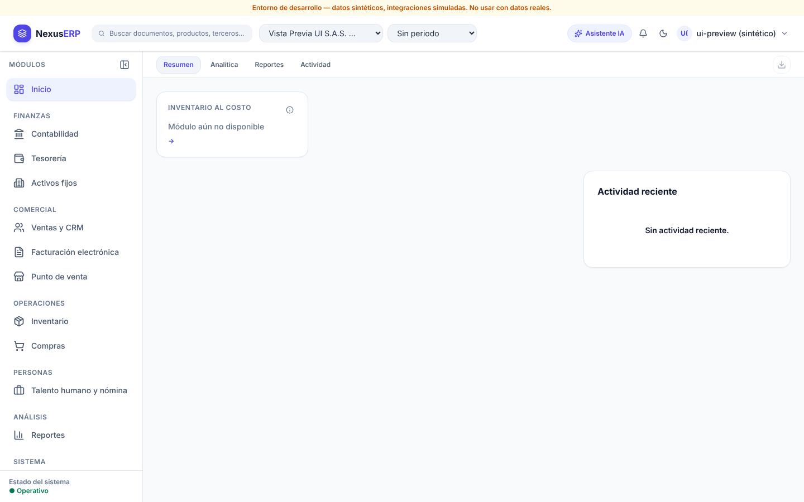

# UI progress (newest first)

Screenshots taken by the integrator after each wave (from wave 02 on), with the system Chrome on the integrated `main`.
Open a wave to see every page in light and dark theme. Synthetic DEV data only.

## [W03](W03/INDEX.md) — OK

## [W02](W02/INDEX.md) — FAILED

