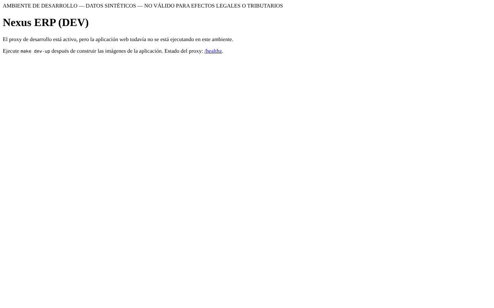
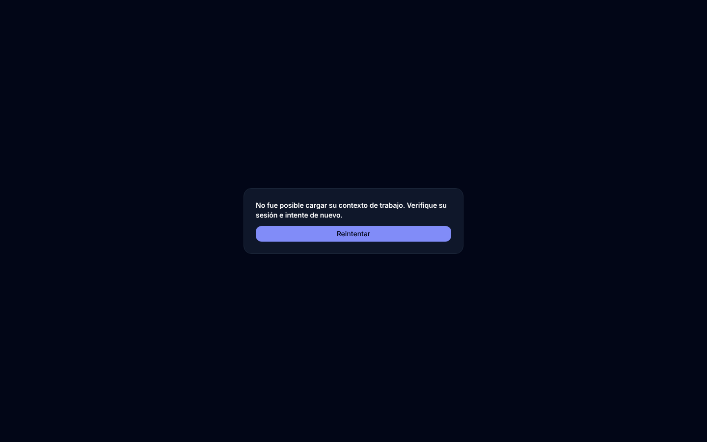

# UI progress — after wave 02

Integrated commit: `98c2c8614213` · captured 2026-11-10T03:46:10Z (UTC) · viewport 1440×900 · device scale 1 · 0.03 MB · browser: system Chrome via Playwright 1.65.0

**Status: FAILED** — login form not found (no sign-in button, and /m/inicio did not redirect to the identity provider)

Synthetic seeded data only (DEV). Password, token and secret fields are masked. Pages not yet built are listed, never faked. Contract notes are automatic measurements against docs/spec/UI-CONTRACT.md §3 (header 64 px, sidebar 256/80 px, AI panel 320 px).

Signed in as: throwaway DEV user `ui-preview` of a synthetic tenant, bootstrapped by tools/dev_login.py (password only in deploy/dev/secrets/ui-preview.env, 0600, rotated each run)

| Page | Route | Theme / variant | Status | Contract notes |
|---|---|---|---|---|
| Login / entry | `/` | light | captured | header not found; sidebar not found; AI panel not found |
| Login / entry | `/` | dark | captured | header not found; sidebar not found; AI panel not found; dark class ✓ |

## Not captured

| Page | Route | Why |
|---|---|---|
| Tesorería | `/m/tesoreria` | not yet built (owner P16 not accepted) |
| Activos fijos | `/m/activos` | not yet built (owner P14 not accepted) |
| Ventas y CRM | `/m/ventas` | not yet built (owner P10 not accepted) |
| Facturación electrónica | `/m/facturacion` | not yet built (owner P15 not accepted) |
| Punto de venta | `/m/pos` | not yet built (owner P12 not accepted) |
| Inventario | `/m/inventario` | not yet built (owner P09 not accepted) |
| Compras | `/m/compras` | not yet built (owner P11 not accepted) |
| Talento humano y nómina | `/m/talento` | not yet built (owner P13 not accepted) |
| Reportes | `/m/reportes` | not yet built (owner P17 not accepted) |
| Importar y exportar | `/m/datos` | not yet built (owner P18 not accepted) |
| Puesta en marcha | `/m/puesta-en-marcha` | not yet built (owner P21 not accepted) |
| Portal de proveedores | `/portal/proveedores` | not captured: portal pages need an external portal account |
| Portal de clientes | `/portal/clientes` | not captured: portal pages need an external portal account |
| Portal de empleados | `/portal/empleados` | not captured: portal pages need an external portal account |

## Gallery

### Login / entry — light

### Login / entry — dark

